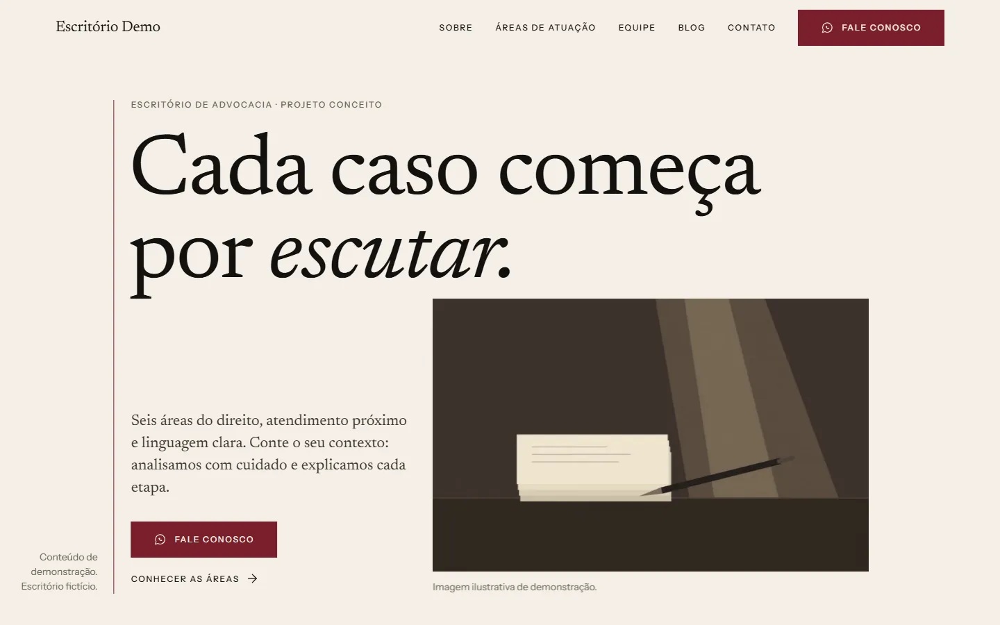

<div align="center">

# Advocacy

**A cinematic website concept for a Brazilian law firm.**
Six areas of law, plain language, one clear way to get in touch.

[](https://advocacy-inky.vercel.app/)




</div>

> **Portfolio project.** The firm, the lawyers and the articles are fictional, and everything is labeled as sample content. No real client or case is represented.

## Highlights

- **Editorial home page** with a cinematic hero, pinned scroll sections, text reveals and smooth scrolling.
- **Six practice areas**, each with its own page: civil, labor, business, family and succession, consumer and tax.
- **Team pages** for each lawyer, generated from MDX files.
- **Blog** with MDX articles, tags and reading time.
- **Contact page** with a WhatsApp click-to-chat button and social links.
- **Privacy policy** written with Brazil's LGPD in mind.
- **Accessible and responsive** from 360px to 1920px, with `prefers-reduced-motion` respected.
- **Fully static.** No database, no CMS, no backend. Content lives in the repo as MDX.

## Tech stack

| Area | Choice |
|---|---|
| Framework | Next.js (App Router), static export |
| Language | TypeScript |
| Styling | Tailwind CSS 4 |
| Content | MDX collections: areas, posts, team (`next-mdx-remote`, `gray-matter`) |
| Motion | GSAP + ScrollTrigger, Lenis smooth scroll |
| Images | `sharp` optimization script |
| Quality | ESLint, `tsc --noEmit` |

## Getting started

```bash
npm install
npm run dev        # http://localhost:3000
```

| Command | What it does |
|---|---|
| `npm run dev` | Start the dev server |
| `npm run build` | Build the static site into `out/` |
| `npm run lint` | Run ESLint |
| `npm run typecheck` | Type-check with TypeScript |
| `npm run images` | Convert the SVG sources in `assets/images-src` to AVIF/WebP in `public/img/opt` |
| `npm run check` | Lint, typecheck and build in order |

## Project structure

```
content/
  areas/        Practice areas (MDX)
  posts/        Blog articles (MDX)
  team/         Lawyer profiles (MDX)
src/
  app/          Routes: home, sobre, áreas de atuação, equipe, blog, contato, privacidade
  components/   home, layout, blog, contact, mdx, providers, ui
  lib/          Content loaders and motion helpers
docs/           Preview image and design critiques
```

## Design notes

The visual system is documented in [`DESIGN.md`](DESIGN.md) and the scope in [`BRIEF.md`](BRIEF.md). The site is in Brazilian Portuguese only.

## Author

Built by **Eduardo Sousa**, web developer in Belo Horizonte, Brazil.

[Portfolio](https://oeduardosousa.com) · [LinkedIn](https://www.linkedin.com/in/eduardo-sousa-528b77334) · [GitHub](https://github.com/oeduardosousa)
